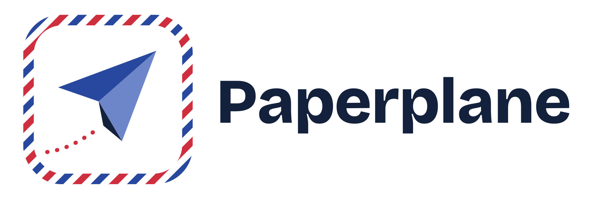

<p align="center">
  
</p>

<p align="center"><b>Send money like a message.</b><br>
A link and a note, opened only by the person you meant, and yours to take back until they collect it.</p>

<p align="center">
  <a href="https://paperplane-monad.vercel.app"><b>Try it live</b></a> ·
  Built for the Monad Metropolis hackathon, Consumer Products &amp; Payments track
</p>

---

## The problem

Families who send money across borders still rely on bank transfers that take days, need the recipient's account details up front, and cannot be undone if a digit is wrong.

Our starting user is the Indian family supporting a student abroad. MEA data puts the number of Indians in higher education abroad at over 1.25 million, mostly in Canada, the US, the UK and Australia. Every month, parents send rent and living money, and World Bank data shows banks charging around 11.5% on average to send $200 (late 2023), roughly double the cost of specialist transfer services.

## What Paperplane does

1. **Send.** Pick an amount, write a note, and (recommended) enter the recipient's email. Paperplane locks the money in a smart contract on Monad and gives you a link.
2. **Share.** Send the link on WhatsApp or anywhere else. It opens as a letter: who it's from, the amount, and your handwritten-style note.
3. **Collect.** The recipient signs in with their email, using a one-time code. No app, no wallet, no fees. The money is theirs in about a second.

The blockchain stays invisible: no wallet addresses, no gas, no seed phrases.

### Built-in protection against mistakes

| Mistake | What protects you |
|---|---|
| The link is forwarded or leaked | **Addressed paperplanes:** only someone who signs in with the email you chose can collect. Anyone else is refused. |
| Wrong amount, wrong person, or second thoughts | **Take it back:** the sender can cancel any time before the money is collected. |
| Link sent to the wrong chat | **1-hour safety hold** (optional, on by default): the money can't be collected for an hour, so there's time to notice and take it back. |
| Nobody ever collects | After 7 days the money can be returned to the sender. |

## How it works

```
Sender (email sign-in)                          Recipient (email sign-in)
      |                                                   ^
      | 1. deposit(amount, claimKey, lock, hold)          | 4. money arrives
      v                                                   |
 +-----------------------  LinkEscrow (Monad)  ------------------------+
 |  holds the money; releases it only to an address signed by the      |
 |  link's one-time key, plus (for addressed links) the gatekeeper     |
 +---------------------------------------------------------------------+
      ^                                                   ^
      | 2. link = one-time key + note (after the "#")     | 3. claim, submitted by our
      |    shared on WhatsApp                             |    relayer, which pays the fee
```

- **One-time key in the link.** Each paperplane gets a fresh key, stored after the `#` in the link so browsers never send it to any server. To collect, the recipient's browser uses it to sign "pay this to my account". The contract checks that signature, so whoever submits the transaction can't redirect the money.
- **Addressed links.** The contract stores only a salted hash of the recipient's email, so the email is never published on chain. When someone collects, our server verifies their Privy sign-in, checks the email matches the hash, and adds a gatekeeper signature that the contract requires. The link alone isn't enough, and the gatekeeper alone isn't enough either.
- **Invisible fees.** A relayer pays the network fees for collecting, and new accounts receive a small amount of MON to cover sending. Users never see gas.
- **Email accounts.** Privy creates an embedded wallet for each person who signs in with email. Users never handle keys.

## Security, honestly

**What already holds:**
- Money sits in the contract, not with the Paperplane team.
- An addressed paperplane can't be collected by anyone else, even with the link.
- The server can neither redirect nor take money: collecting needs the link's key, and addressed links also need the gatekeeper's approval.
- 36 contract tests cover attacks such as swapped recipients, forged and reused signatures, double claims, early collection during a hold, and cancels by anyone other than the sender.

**What isn't ready for real money yet:**
- The contract has not been professionally audited.
- The gatekeeper and relayer key lives in the server's environment. If stolen, it still couldn't take money without the link, but it could approve or block addressed claims. Production would move it to a managed key service.
- Accounts rely on Privy's embedded wallets, which is a trust assumption.
- This runs on Monad testnet with test dollars ("MockUSD"). A real launch needs a regulated stablecoin, licensed partners for rupee on-ramps and cash-out, and KYC and AML compliance under RBI and FEMA rules.

## Try it (for judges)

1. Open **https://paperplane-monad.vercel.app** and sign in with any email address. You'll get a one-time code.
2. Click **Add $100 test money**.
3. Send a paperplane: amount `5`, a name and a note. In **Their email**, enter a second email you own (with Gmail you can add `+test` before the `@`, e.g. `you+test@gmail.com`). Untick the safety hold to collect straight away.
4. Copy the link and open it in a private or incognito window.
5. Try collecting with a **different** email first: it's refused. Then sign in with the addressed email: collected.
6. Back in the first window, send another one and use **Take it back** before it's collected.

No real money is involved.

## Deployed contracts (Monad testnet, chain ID 10143)

| Contract | Address |
|---|---|
| LinkEscrow | `0x7d9b21730340ad19d713c2ecddcea133cc8d39bf` |
| MockUSD (test dollar, 6 decimals) | `0x3eDC08727E579D72a6D38C2eB2d0152772F22bD9` |
| Gatekeeper / relayer | `0x261D372Bc7BDBd659e5706B057EdE6884FEf6d2b` |

## Repository layout

```
contracts/   Solidity (Foundry): LinkEscrow, MockUSD, tests, deploy scripts
web/         Next.js app: send and claim screens, API routes for the relayer,
             gatekeeper, account funding, and a network proxy
assets/      Logo
```

## Run it yourself

**Contracts**

```bash
cd contracts
forge install OpenZeppelin/openzeppelin-contracts@v5.1.0   # if lib/ is missing
forge test
GATEKEEPER=0xYourGatekeeperAddress forge script script/Deploy.s.sol \
  --rpc-url monad_testnet --account deployer --broadcast
```

**Web app** (`web/.env.local`)

```
NEXT_PUBLIC_PRIVY_APP_ID=...        # from the Privy dashboard
PRIVY_APP_SECRET=...                # Privy app secret (server only)
NEXT_PUBLIC_ESCROW_ADDRESS=0x...    # LinkEscrow
NEXT_PUBLIC_USD_ADDRESS=0x...       # MockUSD
RELAYER_PRIVATE_KEY=0x...           # funded with test MON; also the gatekeeper key
```

```bash
cd web
npm install
npm run dev
```

## Tech stack

Monad testnet · Solidity 0.8 and OpenZeppelin · Foundry · Next.js · viem · Privy (email sign-in and embedded wallets) · Tailwind CSS · Vercel

## What's next

1. **Real money rails:** a regulated stablecoin on Monad mainnet, rupee top-ups through UPI via a licensed partner, cash-out to the recipient's local bank, and a professional audit.
2. **Phone numbers:** sign-in and addressing by phone are already written in the code, and switch on once SMS sign-in covers India.
3. **More ways to send:** monthly allowances, paperplanes that open on a chosen date (rent on the 1st, a birthday), group gifts.
4. **More routes:** other family corridors, such as Gulf workers sending money home.
5. **Business model:** a small fee on cash-out, kept well below what banks charge.

## User testing

_To be filled in with what our testers said._

## Team

_Team name, members and roles to be added._
